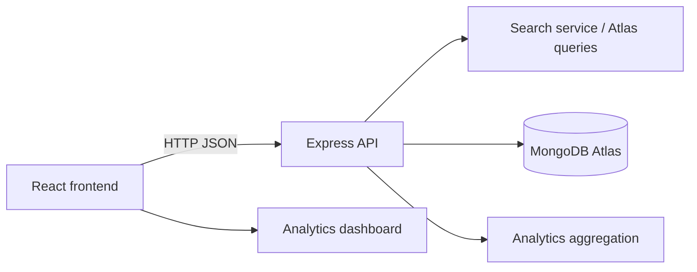

# SmartSearch

SmartSearch is a MongoDB portfolio project that demonstrates baseline text search, Atlas Search, fuzzy matching, autocomplete, filter/facet UX, comparison flows, and a public analytics dashboard in a small TypeScript monorepo.

## Overview

This project is designed to show multiple MongoDB search patterns side-by-side in a single application:

- Baseline MongoDB `$text` search
- Atlas Search advanced search with facets and fuzzy matching
- Autocomplete and suggestion queries
- Category and tag filtering
- Pagination, sorting, and result summaries
- Baseline vs Atlas comparison view
- Public analytics dashboard with aggregated metrics only

## Technology stack

- Frontend: React, TypeScript, Vite, Tailwind CSS
- Backend: Node.js, Express, TypeScript
- Database: MongoDB Atlas / official MongoDB Node.js driver
- Testing: Vitest + Supertest
- Package management: npm workspaces

## Architecture



## Repository structure

```text
smartsearch/
├── README.md
├── docs/
│   └── atlas-search.md
├── package.json
├── .gitignore
├── packages/
│   ├── backend/
│   │   ├── .env.example
│   │   ├── package.json
│   │   ├── src/
│   │   └── tests/
│   └── frontend/
│       ├── .env.example
│       ├── package.json
│       ├── src/
│       └── public/
└── package-lock.json
```

## Features implemented

### Search

- Baseline `$text` search against MongoDB documents
- Atlas Search advanced search and fuzzy matching
- Autocomplete suggestions
- Category and tag filters
- Facets from Atlas Search when enabled
- Pagination and sorting logic for baseline and Atlas paths
- Reset-to-page-one on filter/search changes

### Comparison

- Side-by-side Baseline vs Atlas comparison page
- Shared query, category, and tag context
- Native result ordering and elapsed time displayed per engine

### Analytics

- Search event recording on successful backend searches
- Sanitized query storage for dashboarding
- Aggregate overview endpoint for 7-day and 30-day views
- Dashboard with KPI cards, daily activity, engine usage, and filter usage
- Public analytics response hides readable query strings

## Prerequisites

- Node.js 20+
- npm 10+
- MongoDB Atlas cluster with a database and collection named `documents`
- Atlas Search indexes for `documents_search` and `documents_autocomplete` if you want advanced search and autocomplete enabled

## Local setup

From the repository root:

```bash
npm install
```

### Backend

Copy the backend example env file and update values as needed:

```bash
cp packages/backend/.env.example packages/backend/.env
```

### Frontend

```bash
cp packages/frontend/.env.example packages/frontend/.env
```

Then run:

```bash
npm run dev
```

This starts the Express API and Vite frontend together.

- Backend: http://localhost:4000
- Frontend: http://localhost:5173

## Environment variables

### Backend

File: `packages/backend/.env.example`

```env
PORT=4000
NODE_ENV=development
MONGODB_URI=mongodb+srv://<username>:<password>@<cluster-host>/<database>?retryWrites=true&w=majority
MONGODB_DB=smartsearch
CORS_ORIGIN=http://localhost:5173,http://127.0.0.1:5173
```

Notes:

- `MONGODB_URI` is required for a live database connection.
- `MONGODB_DB` is optional if it is already present in the URI.
- `CORS_ORIGIN` must be explicit. In production, wildcard `*` is rejected.
- `CORS_ORIGIN` supports a comma-separated allowlist.

### Frontend

File: `packages/frontend/.env.example`

```env
VITE_API_URL=http://localhost:4000
```

## Atlas Search setup requirements

The project expects the following Atlas Search indexes to exist in the Atlas UI or via the Atlas Administration API:

- `documents_search`
- `documents_autocomplete`

The backend includes the index definitions and status checks to validate readiness. Without these indexes, the Atlas Search routes return a clean fallback error while the baseline search continues to work.

## Testing, linting and builds

Run from the repo root:

```bash
npm run typecheck --workspaces --if-present
npm run lint --workspaces --if-present
npm run test --workspaces --if-present
npm run build --workspaces --if-present
```

For serial Vitest execution on constrained environments:

```bash
cd packages/backend && npx vitest run --maxWorkers=1 --minWorkers=1 --no-file-parallelism
cd packages/frontend && npx vitest run --maxWorkers=1 --minWorkers=1 --no-file-parallelism
```

## Analytics privacy and retention

The public analytics overview is intentionally privacy-aware.

- Raw user-entered search terms are not returned from the public overview API.
- Aggregate metrics such as totals, daily volume, latency, engine usage, and filter activity remain available.
- Search event storage still sanitizes and timestamps events, but public dashboard output hides readable query strings.
- The project keeps a short retention period for analytics event documents and does not add an authentication layer to the public demo.

## Current limitations and future improvements

Implemented and working:

- MongoDB `$text` and Atlas Search flows
- Filtered, faceted, and paginated search UX
- Search comparison experience
- Analytics dashboard with privacy-preserving summaries

Not part of the current scope:

- Authentication or user accounts
- Vector search / semantic search
- Multi-tenant or production analytics platform features
- Full production deployment automation

## Deployment preparation notes

This project is a portfolio/demo application rather than a production SaaS system.

### Vercel backend

Deploy the backend from the repository root so Vercel can discover the root
npm workspace lockfile and the `api/` function:

- **Root Directory:** `.` (repository root)
- **Build Command:** `npm run build --workspace packages/backend`
- **Output Directory:** `public`

The `public/` directory is an empty placeholder required by Vercel's `Other`
framework preset. API requests are served by the function, not static files.

Vercel discovers `api/[...path].ts` and routes `/api/*` requests through the
Express application. Set these backend environment variables in the Vercel
project:

- `MONGODB_URI` (required for database-backed endpoints)
- `MONGODB_DB` (optional if the database name is included in `MONGODB_URI`)
- `CORS_ORIGIN` (required in production; the deployed frontend origin or
  comma-separated allowed origins)
- `NODE_ENV=production`

`PORT` is only used by the local server; Vercel supplies the serverless request
handler and does not need this variable.

Before deploying publicly:

- Set `NODE_ENV=production`
- Configure a strict `CORS_ORIGIN` allowlist
- Ensure Atlas Search indexes are ready and queryable
- Keep `.env` files local and never commit them
- Validate analytics privacy and public response data before exposing the app
- Review any additional operational monitoring requirements for your target deployment environment
